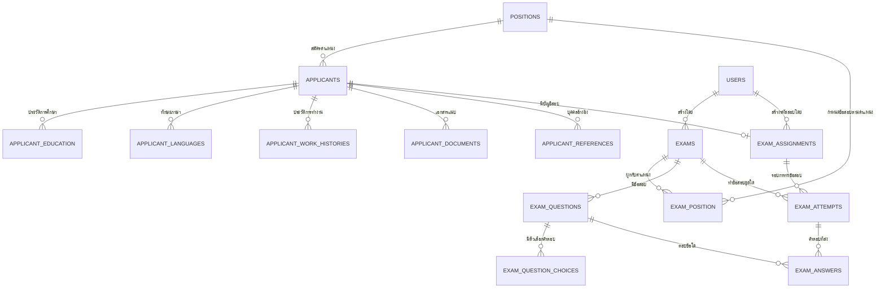

# พจนานุกรมข้อมูลและโครงสร้างฐานข้อมูล (Database Schema & Data Dictionary)
## ระบบรับสมัครงานและทดสอบออนไลน์ SKP

---

## 1. แผนภาพความสัมพันธ์ของเอนทิตี (Entity-Relationship Diagram)

---

## 2. พจนานุกรมข้อมูล (Data Dictionary)

### 2.1 ตาราง `users` (ผู้ใช้งานระบบ / HR Admin)
| ฟิลด์ | ชนิดข้อมูล | เงื่อนไข | คำอธิบาย |
| :--- | :--- | :--- | :--- |
| `id` | BIGINT | PK, Auto Increment | รหัสผู้ใช้งาน |
| `name` | VARCHAR(255) | Not Null | ชื่อ-นามสกุล |
| `username` | VARCHAR(255) | Unique, Not Null | ชื่อบัญชีเข้าสู่ระบบ |
| `email` | VARCHAR(255) | Unique, Not Null | อีเมล |
| `role` | VARCHAR(50) | Default: 'admin' | สิทธิ์การใช้งาน (`admin`) |
| `password` | VARCHAR(255) | Not Null | รหัสผ่านเข้ารหัส HASH |

---

### 2.2 ตาราง `positions` (ตำแหน่งงานที่เปิดรับ)
| ฟิลด์ | ชนิดข้อมูล | เงื่อนไข | คำอธิบาย |
| :--- | :--- | :--- | :--- |
| `id` | BIGINT | PK, Auto Increment | รหัสตำแหน่งงาน |
| `title` | VARCHAR(255) | Unique, Not Null | ชื่อตำแหน่งงาน (เช่น Programmer, HR Officer) |
| `is_active` | BOOLEAN | Default: true | สถานะการเปิดรับสมัคร |

---

### 2.3 ตาราง `applicants` (ข้อมูลผู้สมัครงาน)
สร้างตามแบบฟอร์ม FS-A21-001 (E) มีกลุ่มข้อมูลหลักดังนี้:
| ฟิลด์ | ชนิดข้อมูล | เงื่อนไข | คำอธิบาย |
| :--- | :--- | :--- | :--- |
| `id` | BIGINT | PK, Auto Increment | รหัสผู้สมัคร |
| `position_id` | BIGINT | FK -> `positions.id` | ตำแหน่งที่สมัคร |
| `expected_salary`| DECIMAL(10,2)| Nullable | เงินเดือนที่คาดหวัง |
| `title_th`, `first_name_th`, `last_name_th`, `nickname_th` | VARCHAR | Not Null / Nullable | ข้อมูลชื่อภาษาไทย |
| `title_en`, `first_name_en`, `last_name_en`, `nickname_en` | VARCHAR | Not Null / Nullable | ข้อมูลชื่อภาษาอังกฤษ |
| `date_of_birth` | DATE | Not Null | วันเดือนปีเกิด |
| `nationality`, `ethnicity`, `religion`, `gender` | VARCHAR | Not Null / Nullable | ข้อมูลส่วนตัว |
| `height_cm`, `weight_kg` | DECIMAL(5,1) | Nullable | ส่วนสูง (ซม.) และน้ำหนัก (กก.) |
| `marital_status` | VARCHAR | Not Null | สถานภาพสมรส |
| `has_congenital_disease`, `congenital_disease_detail` | BOOLEAN, TEXT | Nullable | ประวัติโรคประจำตัว |
| `has_criminal_record`, `criminal_record_detail` | BOOLEAN, TEXT | Nullable | ประวัติคดีอาญา |
| `has_lese_majeste_record`, `lese_majeste_detail` | BOOLEAN, TEXT | Nullable | ประวัติคดี ม.112 |
| `current_address`, `phone`, `email`, `line_id` | TEXT, VARCHAR | Not Null / Nullable | ข้อมูลการติดต่อ |
| `national_id_number` | VARCHAR(13) | Unique, Not Null | เลขประจำตัวประชาชน 13 หลัก |
| `national_id_back_number` | VARCHAR(20) | Nullable | เลขหลังบัตรประชาชน (Laser ID) |
| `military_status` | VARCHAR | Nullable | สถานะทางทหาร (ผ่านการเกณฑ์/ได้รับการยกเว้น) |
| `status` | ENUM | Default: `'draft'` | สถานะของผู้สมัคร: `draft`, `submitted`, `qualified`, `disqualified`, `code_generated`, `awaiting_review`, `passed_test`, `failed_test` |
| `hr_blacklist_checked`, `hr_criminal_checked`, `hr_social_checked` | BOOLEAN | Default: false | ผลการตรวจสอบคัดกรองของ HR |
| `hr_verification_note` | TEXT | Nullable | บันทึกการตรวจสอบของ HR |
| `reviewed_by` | BIGINT | FK -> `users.id` | เจ้าหน้าที่ HR ที่ตรวจสอบ |
| `reviewed_at` | DATETIME | Nullable | วันเวลาที่ทำการตรวจสอบ |

---

### 2.4 ตารางชุดข้อมูลประกอบของผู้สมัคร (Applicant Relations)
- **`applicant_education`**: บันทึกระดับการศึกษา, ชื่อสถาบัน, สาขาวิชา, ปีที่เข้า-จบ, เกรดเฉลี่ย (GPA)
- **`applicant_languages`**: ทักษะภาษาต่างประเทศ, ระดับการพูด/อ่าน/เขียน
- **`applicant_work_histories`**: ประวัติการทำงานเดิม, บริษัท, ตำแหน่ง, เงินเดือนเริ่มต้น/สิ้นสุด, สาเหตุที่ลาออก
- **`applicant_documents`**: ไฟล์แนบ (สำเนาบัตรประชาชน, ทะเบียนบ้าน, เอกสารวุฒิการศึกษา, เรซูเม) จัดเก็บพาธไว้แบบ Secure
- **`applicant_references`**: บุคคลอ้างอิงที่ไม่ใช่ญาติ, ชื่อ, ตำแหน่ง, ที่ทำงาน, เบอร์โทรศัพท์

---

### 2.5 ตาราง `exams` (ชุดแบบทดสอบ)
| ฟิลด์ | ชนิดข้อมูล | เงื่อนไข | คำอธิบาย |
| :--- | :--- | :--- | :--- |
| `id` | BIGINT | PK, Auto Increment | รหัสแบบทดสอบ |
| `name` | VARCHAR(255) | Not Null | ชื่อชุดข้อสอบ |
| `description` | TEXT | Nullable | คำชี้แจงในการทำข้อสอบ |
| `duration_minutes` | INT | Default: 60 | เวลาที่ให้ทำข้อสอบ (นาที) |
| `pass_percentage` | DECIMAL(5,2) | Default: 60.00 | เกณฑ์คะแนนขั้นต่ำที่ถือว่าผ่าน (%) |
| `target_type` | ENUM | `'all'`, `'specific'` | ข้อสอบสำหรับทุกตำแหน่ง หรือเฉพาะบางตำแหน่ง |
| `status` | ENUM | `'draft'`, `'published'` | สถานะการใช้งานแบบทดสอบ |
| `created_by` | BIGINT | FK -> `users.id` | ผู้สร้างชุดข้อสอบ |

---

### 2.6 ตาราง `exam_questions` (ข้อคำถาม)
| ฟิลด์ | ชนิดข้อมูล | เงื่อนไข | คำอธิบาย |
| :--- | :--- | :--- | :--- |
| `id` | BIGINT | PK, Auto Increment | รหัสข้อสอบย่อย |
| `exam_id` | BIGINT | FK -> `exams.id` | ชุดข้อสอบที่สังกัด |
| `question_type` | ENUM | `'single_choice'`, `'multi_choice'`, `'essay'` | ประเภทข้อสอบ: ปรนัยเลือกตอบ 1 ข้อ, ปรนัยเลือกหลายข้อ, หรืออัตนัยเขียนตอบ |
| `question_text` | TEXT | Not Null | เนื้อหาคำถาม |
| `question_image_path` | VARCHAR(255) | Nullable | ภาพประกอบโจทย์คำถาม (ถ้ามี) |
| `points` | DECIMAL(5,2) | Default: 1.00 | คะแนนเต็มประจำข้อ |
| `order_no` | INT | Default: 1 | ลำดับการแสดงข้อสอบ |

---

### 2.7 ตาราง `exam_question_choices` (ตัวเลือกคำตอบ)
| ฟิลด์ | ชนิดข้อมูล | เงื่อนไข | คำอธิบาย |
| :--- | :--- | :--- | :--- |
| `id` | BIGINT | PK, Auto Increment | รหัสตัวเลือก |
| `exam_question_id`| BIGINT | FK -> `exam_questions.id`| ข้อสอบที่สังกัด |
| `choice_text` | TEXT | Not Null | ข้อความตัวเลือก |
| `is_correct` | BOOLEAN | Default: false | เป็นคำตอบที่ถูกต้องหรือไม่ |
| `order_no` | INT | Default: 1 | ลำดับตัวเลือก (1=ก, 2=ข, ...) |

---

### 2.8 ตาราง `exam_assignments` (การมอบหมายสิทธิ์สอบ / บัญชีผู้สอบ)
| ฟิลด์ | ชนิดข้อมูล | เงื่อนไข | คำอธิบาย |
| :--- | :--- | :--- | :--- |
| `id` | BIGINT | PK, Auto Increment | รหัสการมอบหมาย |
| `applicant_id` | BIGINT | FK -> `applicants.id` | ผู้สมัครที่ได้รับสิทธิ์สอบ |
| `username` | VARCHAR(255) | Unique, Not Null | รหัสผู้ใช้สำหรับล็อกอินเข้าห้องสอบ |
| `password_encrypted` | TEXT | Not Null | รหัสผ่านแบบเข้ารหัสสองทาง (HR ดูได้ / ผู้สอบใช้ล็อกอิน) |
| `exam_deadline` | DATE | Not Null | วันสุดท้ายที่สามารถเข้าทำข้อสอบได้ |
| `created_by` | BIGINT | FK -> `users.id` | เจ้าหน้าที่ผู้สร้างสิทธิ์ |

---

### 2.9 ตาราง `exam_attempts` (รอบการเข้าทำแบบทดสอบ)
| ฟิลด์ | ชนิดข้อมูล | เงื่อนไข | คำอธิบาย |
| :--- | :--- | :--- | :--- |
| `id` | BIGINT | PK, Auto Increment | รหัสรอบการสอบ |
| `exam_assignment_id`| BIGINT | FK -> `exam_assignments.id` | อ้างอิงสิทธิ์สอบ |
| `exam_id` | BIGINT | FK -> `exams.id` | แบบทดสอบที่ทำ |
| `started_at` | DATETIME | Nullable | วันเวลาที่กดเริ่มสอบ (ใช้จับเวลาร่วมกับ duration) |
| `submitted_at` | DATETIME | Nullable | วันเวลาที่ส่งข้อสอบ |
| `status` | ENUM | `'in_progress'`, `'submitted'`, `'reviewed'` | สถานะการทำข้อสอบ |
| `score` | DECIMAL(5,2) | Default: 0.00 | คะแนนรวมที่ได้ |
| `suspicious_activity_count` | UNSIGNED INT | Default: 0 | จำนวนครั้งที่ระบบตรวจพบพฤติกรรมน่าสงสัย (สลับแท็บ/หลุดจอ) |
| `suspicious_activity_log` | JSON | Nullable | บันทึก Log รายละเอียดเหตุการณ์ เช่น `[{"type": "visibility_change", "at": "..."}]` |

---

### 2.10 ตาราง `exam_answers` (คำตอบของแต่ละข้อ)
| ฟิลด์ | ชนิดข้อมูล | เงื่อนไข | คำอธิบาย |
| :--- | :--- | :--- | :--- |
| `id` | BIGINT | PK, Auto Increment | รหัสคำตอบ |
| `exam_attempt_id` | BIGINT | FK -> `exam_attempts.id`| อ้างอิงรอบการสอบ |
| `exam_question_id`| BIGINT | FK -> `exam_questions.id`| อ้างอิงข้อคำถาม |
| `selected_choice_id` | BIGINT | Nullable, FK -> choices | ตัวเลือกที่ตอบ (กรณี single_choice) |
| `selected_choice_ids` | JSON | Nullable | อาร์เรย์ของตัวเลือก (กรณี multi_choice) |
| `text_answer` | TEXT | Nullable | ข้อความคำตอบ (กรณี essay) |
| `file_attachment_path`| VARCHAR(255) | Nullable | ไฟล์แนบคำตอบอัตนัย (เช่น รูปภาพหรือโค้ด) |
| `score_awarded` | DECIMAL(5,2) | Default: 0.00 | คะแนนที่ได้ในข้อนี้ |
| `is_reviewed` | BOOLEAN | Default: false | ได้รับการตรวจคะแนนแล้วหรือไม่ |
| `review_note` | TEXT | Nullable | ความเห็นประกอบการตรวจของ HR |
