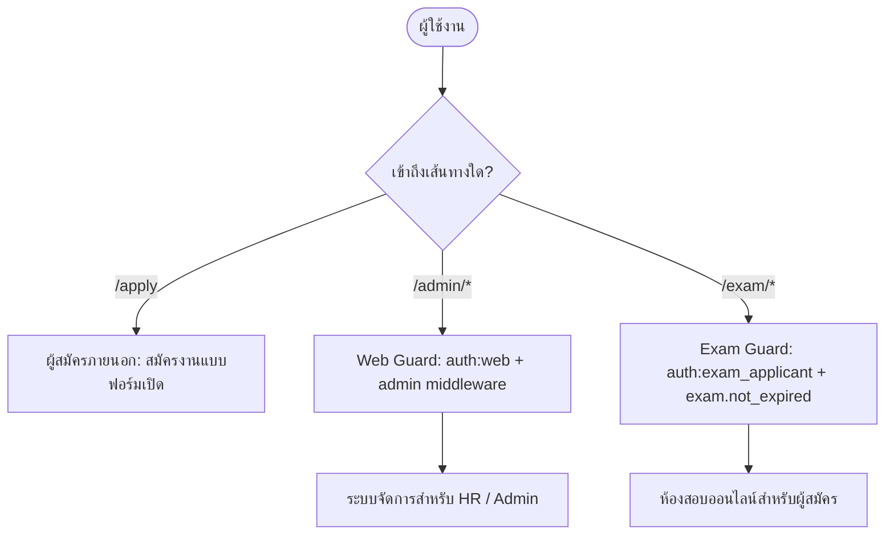
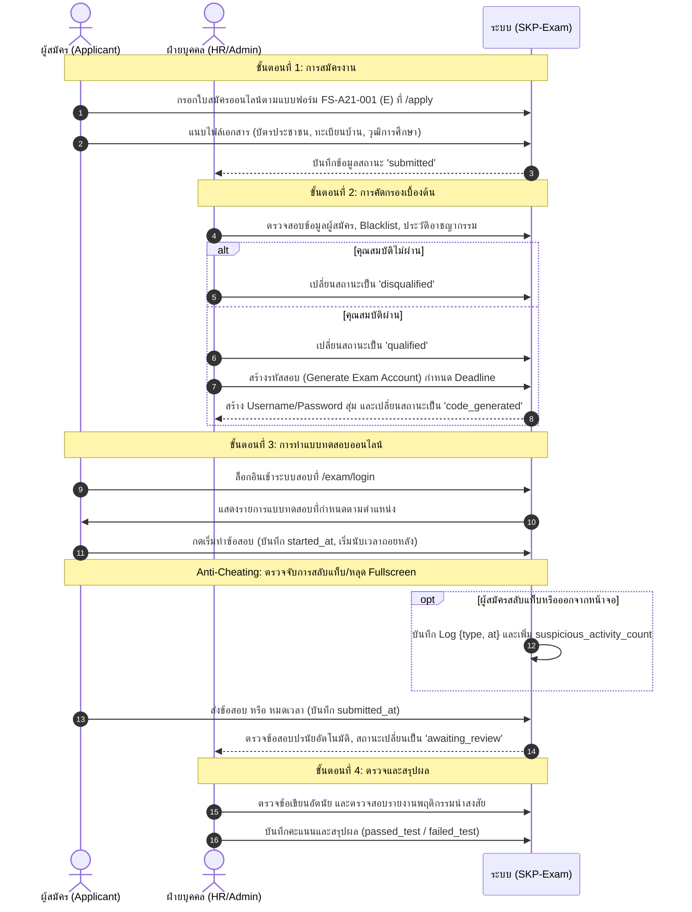

# เอกสารข้อกำหนดระบบ (System Specification)
## ระบบรับสมัครงานและทดสอบออนไลน์ SKP (SKP Recruitment & Online Examination System)

---

## 1. ภาพรวมระบบ (System Overview)

**SKP-Exam** คือเว็บแอปพลิเคชันสำหรับบริหารจัดการกระบวนการรับสมัครงานและทดสอบผู้สมัครงานแบบครบวงจรของเครือ **Grand SK / SKP** พัฒนาขึ้นเพื่อทดแทนกระบวนการกรอกเอกสารกระดาษตามแบบฟอร์มมาตรฐาน **FS-A21-001 (E) ใบสมัครงาน (สำหรับพนักงานรายเดือน)** และรวมระบบสอบคัดเลือกออนไลน์ (Online Assessment) พร้อมระบบป้องกันและตรวจจับการทุจริตไว้ในแพลตฟอร์มเดียวกัน

### วัตถุประสงค์หลัก
1. **Digital Application Workflow**: เปิดให้ผู้สมัครกรอกประวัติ ข้อมูลส่วนบุคคล ประวัติการศึกษา ประสบการณ์ทำงาน และอัปโหลดเอกสารสำคัญผ่านหน้าเว็บที่รองรับอุปกรณ์ทุกประเภท
2. **HR Screening & Verification**: เจ้าหน้าที่ฝ่ายทรัพยากรบุคคล (HR) สามารถตรวจสอบคุณสมบัติ ตรวจสอบประวัติอาชญากรรม ตรวจสอบ Blacklist และคัดกรองผู้สมัครได้อย่างเป็นระบบ
3. **Automated & Flexible Exam Engine**: สร้างและจัดการชุดข้อสอบได้ตามตำแหน่งงาน รองรับข้อสอบทั้งแบบปรนัย (Single Choice, Multiple Choice) และอัตนัย (Essay พร้อมแนบไฟล์)
4. **Anti-Cheating Monitoring**: ตรวจจับพฤติกรรมน่าสงสัยระหว่างสอบ เช่น การสลับแท็บเบราว์เซอร์ การออกจากโหมดเต็มหน้าจอ (Fullscreen) และการสลับหน้าต่าง โดยบันทึก Log และจำนวนครั้งให้ HR ตรวจสอบ
5. **Grading & Comprehensive Summary**: ระบบตรวจคะแนนอัตโนมัติสำหรับปรนัย พร้อมระบบตรวจให้คะแนนข้อเขียนสำหรับ HR และหน้าสรุปผลภาพรวมผู้สมัครแบบครบวงจร

---

## 2. สถาปัตยกรรมและเทคโนโลยี (Architecture & Tech Stack)

| องค์ประกอบ | เทคโนโลยีที่เลือกใช้ | รายละเอียด |
| :--- | :--- | :--- |
| **Backend Framework** | **Laravel 13** | สถาปัตยกรรม MVC ทันสมัย ประสิทธิภาพสูง |
| **Programming Language** | **PHP 8.4+** | รองรับฟีเจอร์ใหม่ การจัดสรรหน่วยความจำและไวยากรณ์ล่าสุด |
| **Interactive UI** | **Livewire 3 + Volt** | Full-stack reactive components แบบ Single-File Components (SFC) โดยไม่ต้องพึ่ง SPA Framework แยก |
| **Frontend Utilities** | **Alpine.js 3** | สำหรับ DOM manipulation ฝั่ง Client-side (การจับเวลา, ตรวจจับการสลับแท็บ) |
| **Styling** | **Tailwind CSS 3** | Utility-first CSS framework ดีไซน์สวยงาม responsive และมีเอกลักษณ์ |
| **Database** | **MySQL / SQLite** | SQLite สำหรับ Local Development / Automated Testing และ MySQL สำหรับ Production |
| **Document/PDF Engine**| **Barryvdh DomPDF** | สำหรับแสดงและสร้างเอกสาร PDF ใบสมัครงาน |
| **Spreadsheet Engine** | **PhpSpreadsheet** | สำหรับจัดการและส่งออกข้อมูล (Export) ในรูปแบบ Excel |

---

## 3. สถาปัตยกรรมความปลอดภัยและระบบสิทธิ์ (Security & Authentication)

ระบบใช้ระบบยืนยันตัวตนแบบหลายระดับ (Multi-Guard Authentication):



### 3.1 บัญชีผู้ดูแลระบบ (Admin Guard: `web`)
- ใช้ตาราง `users` มีฟิลด์ `role = 'admin'`
- มี Middleware `auth`, `verified`, `admin` ป้องกันการเข้าถึงหน้าจัดการของผู้ดูแลระบบ

### 3.2 บัญชีผู้สอบ (Exam Applicant Guard: `exam_applicant`)
- ใช้ตาราง `exam_assignments` ผ่าน Custom Auth Guard `exam_applicant`
- เข้าสู่ระบบผ่าน URL `/exam/login` โดยใช้ **Username** และ **Password** ที่ระบบสุ่มสร้างขึ้นโดย HR
- มี Middleware `exam.not_expired` ตรวจสอบวันหมดอายุ (`exam_deadline`) ของรหัสสอบ หากเลยกำหนด ระบบจะปรับสถานะเป็น `failed_test` อัตโนมัติ

### 3.3 การปกป้องไฟล์เอกสารสำคัญ (Secure File Storage)
- เอกสารที่ผู้สมัครอัปโหลด (บัตรประชาชน, สำเนาทะเบียนบ้าน, วุฒิการศึกษา, เรซูเม) และไฟล์คำตอบอัตนัย ถูกจัดเก็บไว้ในไดเรกทอรีส่วนตัว (`storage/app/private/`) ที่ไม่เปิดเป็น Public
- การเปิดดูไฟล์ต้องผ่าน `SecureFileController` ซึ่งตรวจสอบ Session และสิทธิ์การเข้าถึงก่อนส่งข้อมูลแบบ Stream เท่านั้น

---

## 4. โครงสร้างและวงจรการทำงานของระบบ (System Lifecycle & Workflow)



---

## 5. ระบบตรวจจับพฤติกรรมน่าสงสัยระหว่างสอบ (Anti-Cheating Engine)

เพื่อความโปร่งใสและยุติธรรมในการสอบออนไลน์ ระบบมีกลไกตรวจจับพฤติกรรมที่ผิดปกติที่ฝั่ง Client-side ผ่าน Web APIs:
1. **Window Blur & Visibility Change**: ตรวจจับเมื่อผู้สอบสลับไปยังแท็บอื่น หรือย่อหน้าต่างเบราว์เซอร์
2. **Fullscreen Exit Detection**: แจ้งเตือนเมื่อผู้สอบออกจากโหมดเต็มหน้าจอ
3. **Suspicious Activity Logging**: ส่งข้อมูลบันทึกกลับมายัง Route `exam/attempts/{attempt}/suspicious-activity` แบบ Asynchronous ทันที
4. **HR Audit trail**: หน้าตรวจข้อสอบ (`exam-attempt-grade`) จะแสดงจำนวนครั้งและช่วงเวลาที่เกิดเหตุการณ์น่าสงสัย เพื่อให้ HR ใช้ประกอบการพิจารณาให้คะแนน

---

## 6. โครงสร้างไดเรกทอรีสำคัญของโปรเจกต์

```text
SKP-Exam/
├── app/
│   ├── Http/Controllers/       # Controllers สำหรับ Secure Files และ Exam Attempts
│   └── Models/                 # Eloquent Models (Applicant, Exam, Attempt, ฯลฯ)
├── config/                     # การตั้งค่าระบบ, Authentication guards
├── database/
│   ├── migrations/             # ประวัติการปรับปรุงตารางฐานข้อมูล
│   └── seeders/                # ข้อมูลเริ่มต้น (User เริ่มต้น, ตำแหน่งงาน)
├── document/                   # เอกสารประกอบระบบ (Specification, Manual, Schema)
├── resources/
│   ├── css/                    # Tailwind CSS configuration
│   └── views/
│       ├── livewire/pages/
│       │   ├── admin/          # หน้า Volt Components สำหรับผู้ดูแลระบบ
│       │   ├── application/    # หน้าแบบฟอร์มสมัครงานออนไลน์
│       │   ├── auth/           # หน้าเข้าสู่ระบบของผู้ดูแลระบบ
│       │   └── exam/           # หน้าห้องสอบออนไลน์ของผู้สมัคร
│       └── layouts/            # โครงร่างหน้าเว็บ (App, Guest)
└── routes/
    ├── web.php                 # เส้นทางหลักของเว็บ
    └── auth.php                # เส้นทางระบบ Authentication
```
